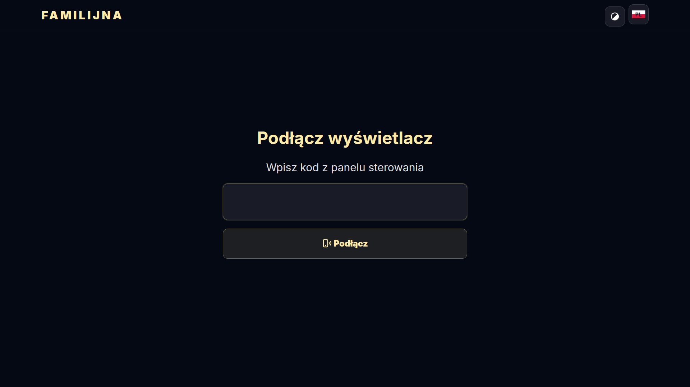
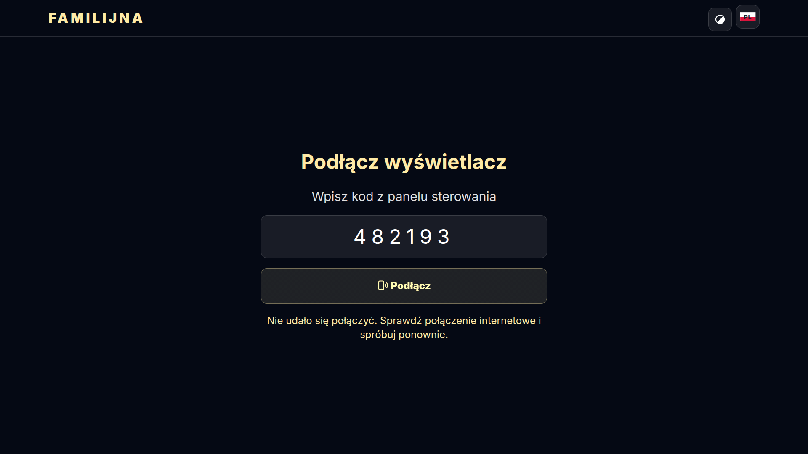
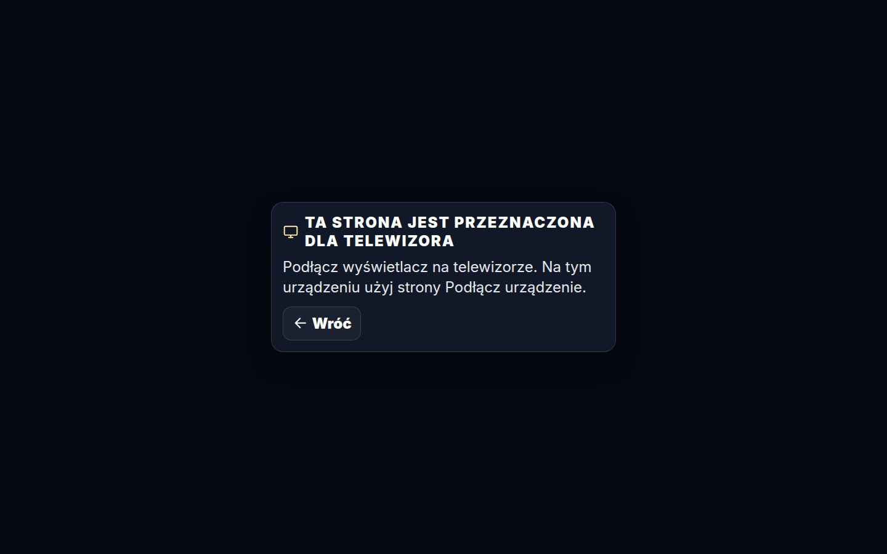
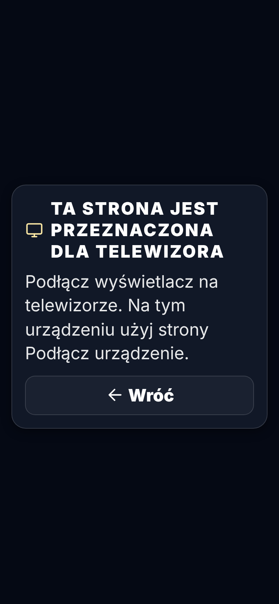

# Zrzuty — 2026-11-05 22:13 UTC

### Podłącz telewizor — kod Wyświetlacza (przeglądarka TV) — pl · 1920×1080

### Podłącz telewizor — kod Prowadzącego (nie dla telewizora) — pl · 1920×1080

### Podłącz telewizor — otwarte na komputerze (tylko telewizor) — pl · desktop

### Podłącz telewizor — otwarte na komputerze (tylko telewizor) — pl · phone

